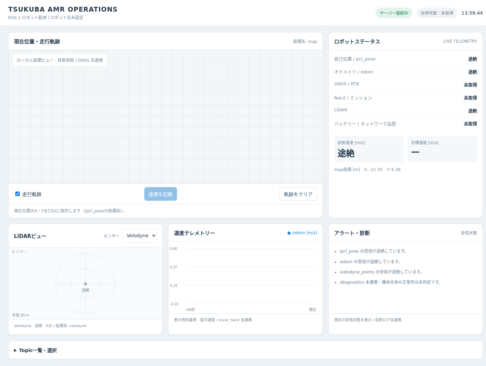

# TSUKUBA AMR OPERATIONS

ROS 2ロボットの位置・速度・LiDARをブラウザで確認する、軽量なWebダッシュボードです。
つくばチャレンジでの現場利用を想定し、同一ネットワークのPCやiPadからアクセスできます。
実機のTopicとrosbag再生のどちらでも利用できます。

**開発中のプロトタイプです。** 現在は固定のTopicを監視する構成で、汎用的なパネル設定やGNSS連携は今後の対応を予定しています。



*画面例：サーバー接続済み・ROSデータ受信途絶時の表示。*

## 主な機能

- **位置・走行軌跡** — ローカル座標系のX・Yと、受信した位置の履歴を表示
- **速度テレメトリー** — 前後速度と直近60秒のグラフを表示
- **LiDARビュー** — Velodyne / Livoxを切り替え、点群を上面から2D表示
- **Topic一覧** — Topic名・メッセージ型・Publisher数を取得
- **座標記録** — ボタン操作で最新のX・YをCSVへ保存
- **受信状態** — データ途絶の表示と、WebSocketの自動再接続

## 構成

```text
ROS 2 Topics
     ↓ rclpy
Python / FastAPI
     ↓ WebSocket・HTTP
HTML / CSS / JavaScript
     ↓
PC・iPadのブラウザ
```

描画にはCanvas APIを使用しています。フロントエンドのビルド処理は不要です。

```text
main.py           ROS購読・API・WebSocket・座標保存
index.html        画面・スタイル・描画処理
requirements.txt  Pythonの直接依存バージョン
docs/images/      スクリーンショット
records/          実行時に生成する座標記録（Git管理対象外）
```

## 必要な環境

- Ubuntu 22.04 / ROS 2 Humble / Python 3.10を想定
- ROS側のPythonパッケージ：`rclpy`、`geometry_msgs`、`nav_msgs`、`sensor_msgs`、`sensor_msgs_py`
- ROSノード間の通信が可能な環境
- JavaScriptとCanvasに対応したブラウザ

Pythonの直接依存バージョンは `requirements.txt` に記載しています。
ROSパッケージはROS環境から読み込むため、pipではインストールしません。

## セットアップ

リポジトリをcloneし、そのディレクトリで実行します。

```bash
source /opt/ros/humble/setup.bash
/usr/bin/python3 -m venv --system-site-packages .venv
source .venv/bin/activate
python -m pip install -r requirements.txt
```

`--system-site-packages` は、仮想環境からROS側のPython依存を参照するために指定しています。

## 起動

リポジトリのディレクトリで実行します。

```bash
source /opt/ros/humble/setup.bash
source .venv/bin/activate
python -m uvicorn main:app --host 0.0.0.0 --port 8000
```

ブラウザで以下を開きます。

| 接続元 | URL |
|---|---|
| サーバーと同じPC | `http://127.0.0.1:8000` |
| 同一ネットワークのiPad・別PC | `http://<サーバーのIPアドレス>:8000` |

終了はターミナルで `Ctrl+C`。Pythonを変更した場合はサーバーを再起動し、HTMLを変更した場合はブラウザを強制再読み込みしてください。

認証機能は未実装です。信頼できるローカルネットワーク内で使用してください。

## 入力Topic

| Topic | メッセージ型 | 用途 |
|---|---|---|
| `/pcl_pose` | `geometry_msgs/msg/PoseWithCovarianceStamped` | 位置・走行軌跡・座標記録 |
| `/odom` | `nav_msgs/msg/Odometry` | 前後速度 `twist.twist.linear.x` |
| `/velodyne_points` | `sensor_msgs/msg/PointCloud2` | Velodyne点群 |
| `/livox/lidar` | `sensor_msgs/msg/PointCloud2` | Livox点群 |

位置と速度は固定Topicを購読します。異なるTopic名を使用する場合は、`main.py` の購読先を変更してください。
LiDARは画面上の選択欄で切り替えられます。選択は接続中の全端末で共有されます。

Topic一覧の「選択」は名前と型の確認のみで、各パネルの購読先は変更しません。

## rosbagで試す

サーバーとは別のターミナルで、対応するTopicを含むbagを再生します。

```bash
source /opt/ros/humble/setup.bash
ros2 bag play /path/to/bag \
  --topics /pcl_pose /odom /velodyne_points /livox/lidar
```

Web配信は約5Hzです。`--rate 10` による10倍速再生では、表示する位置の間隔は記録時刻で約2秒になります。
上記の例は監視用Topicだけを再生し、走行指令は再生しません。

## 座標記録

位置受信中に「座標を記録」を押すと、サーバーが保持する最新のX・Yを `records/waypoint.csv` に追記します。
受信から2秒以上経過した位置や、無効な数値は記録しません。

- 保存値は `/pcl_pose` の座標系におけるX・Yです。
- 緯度経度・向き・時刻は保存しません。
- サーバー再起動後も記録ファイルは残ります。
- `records/` はGit管理対象外です。必要な記録は別途バックアップしてください。

**既知の不具合：** 現在、CSVの初回作成時に最初の座標が2行記録され、見出し行が作成されません。

## API

| エンドポイント | 用途 |
|---|---|
| `GET /` | ダッシュボード |
| `GET /api/topics` | Topic名・型・Publisher数 |
| `POST /api/lidar/select` | LiDARの切り替え |
| `POST /api/waypoints` | 最新のX・Yを保存 |
| WebSocket `/ws` | 位置・速度・LiDAR・受信状態を配信 |

LiDAR切り替えのリクエスト例：

```json
{"sensor": "livox"}
```

`sensor` には `velodyne` または `livox` を指定します。
座標保存APIはリクエストボディ不要で、成功時に `{"x": 数値, "y": 数値}` を返します。

## 制限事項と今後の対応

- **位置ビュー**はローカル座標の軌跡表示です。背景地図や緯度経度との対応は未実装で、中心・縮尺は自動で変化します。
- **LiDARビュー**はセンサー中心の表示です。ロボット基準へのTF変換や地面除去は行いません。表示点は最大1,000点、半径20mに制限しています。
- **受信状態**はアプリへのデータ到着を基準にしています。ロボット全体の正常性や自己位置の正確さを保証するものではありません。
- **GNSS・RTK状態、Nav2状態、指令速度、バッテリー、診断Topic**は未連携です。画面には未取得として表示します。
- **パネルごとのTopic選択・配置変更・レイアウト保存**は今後の対応予定です。

GNSSはSeptentrio mosaic-Hと公式ROS 2ドライバーによる連携を予定しています。
